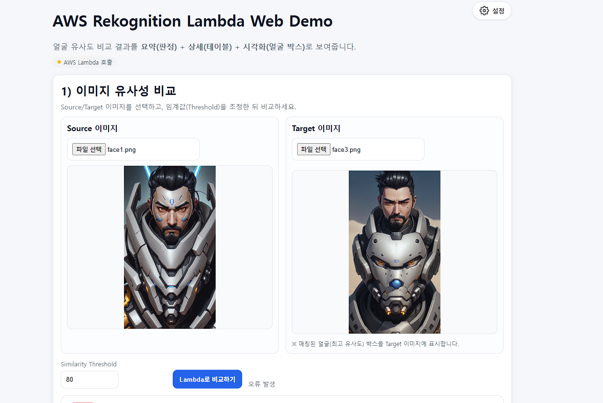
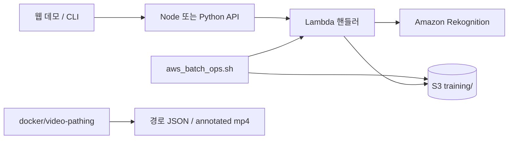

# AWS Rekognition 실습 가이드

Node.js, Lambda, Shell로 Amazon Rekognition 실습을 따라가는 저장소입니다. 같은 기능의 Python 포팅(`server-py/`)과, Rekognition Video People Pathing 대신 쓰는 영상 추적 예제(`docker/video-pathing/`)도 포함합니다.



이 문서의 목표:

1. `server/`에서 얼굴 비교, 텍스트 검출, 라벨 분석을 로컬과 웹으로 실행한다.
2. 샘플 얼굴(`face1.png`, `face2.jpg`, `face3.png`, `face4.jpg`, `face5.png`, `face6.png`)을 S3에 올리고 Lambda로 유사도를 비교한다.
3. `scripts/aws_batch_ops.sh`로 버킷 준비, Lambda 배포, 호출, 결과 수집을 자동화한다.

챕터별 학습 순서는 [doc/README.md](doc/README.md)를 따릅니다. 실습 버킷 이름의 스크립트 기본값은 `polly-bucket-edumgt`입니다. S3 버킷 이름은 전역에서 유일해야 하므로, 이미 사용 중이면 본인 이름으로 바꾸세요.

---

## 목차

- [빠른 시작](#빠른-시작)
- [문서 맵](#문서-맵)
- [활용 기획](#활용-기획)
- [추천 파이프라인](#추천-파이프라인)
- [기술 스택](#기술-스택)
- [디렉터리 구조](#디렉터리-구조)
- [사전 준비](#사전-준비)
- [환경 변수](#환경-변수)
- [로컬 실행](#로컬-실행)
- [웹 데모](#웹-데모)
- [Python 포팅](#python-포팅)
- [영상 사람 추적](#영상-사람-추적)
- [Lambda 배포](#lambda-배포)
- [스크립트 환경 변수](#스크립트-환경-변수)
- [실습 체크리스트](#실습-체크리스트)
- [트러블슈팅](#트러블슈팅)
- [비용과 보안](#비용과-보안)
- [부록](#부록)

---

## 빠른 시작

```bash
cd server
cp .env.example .env   # AWS_REGION, S3_BUCKET_NAME, 자격 증명 수정
npm install
npm run upload:faces
npm run compare:faces
npm run web            # http://localhost:3000
```

Lambda까지 한 번에 돌리려면 저장소 루트에서 역할을 만든 뒤 `./scripts/aws_batch_ops.sh lab-all`을 실행합니다. 절차는 [Lambda 배포](#lambda-배포)를 보세요.

---

## 문서 맵

| 보고 싶은 것 | 문서 |
|---|---|
| 11개 챕터 학습 순서 | [doc/README.md](doc/README.md) |
| Custom Labels, Face Collection | [doc/Chapter11/](doc/Chapter11/) |
| Node 진입 흐름 | [doc/node-entry-flow.md](doc/node-entry-flow.md) |
| Python 포팅과 Docker | [server-py/README.md](server-py/README.md) |
| YOLOv9 + ByteTrack 영상 추적 | [docker/video-pathing/README.md](docker/video-pathing/README.md) |
| IAM Principal / AssumeRole | [부록 A](#appendix-iam) |
| 로컬 실행 보충 | [부록 B](#appendix-local) |
| S3 퍼블릭 접근과 Lifecycle | [부록 C](#appendix-s3) |
| Lambda 조회와 백업 | [부록 D](#appendix-lambda) |

---

## 활용 기획

아래는 Rekognition을 주식·자산운용 시나리오에 어떻게 붙일 수 있는지 정리한 기획입니다. 저장소에 핸들러가 있는 항목만 **구현**으로 표시했습니다. 나머지는 확장 아이디어입니다.

### 1. 대안 데이터로 시장을 읽기

재무제표 밖의 시각 데이터를 실적·트렌드 선행 신호로 쓰는 시나리오입니다.

- **위성·드론 이미지 (`DetectLabels`)**
  - 마트·쇼핑몰 주차장 차량 수로 유통 매출을 가늠합니다.
  - 원유 저장 탱크, 항만 컨테이너처럼 재고·물동량의 시각적 단서를 봅니다.
- **소셜·뉴스 영상 속 신제품 (`DetectLabels`)** — **구현:** `lambda/productMomentumHandler.js`
  - 시간순 프레임에서 워치리스트 물체(스마트폰, 화장품, 자동차 등)의 노출 빈도, 참여도 가중치, 상승/하락 추세를 계산합니다.
  - 사용법은 [신제품 노출 모멘텀](#신제품-노출-모멘텀)을 보세요.

### 2. 미디어 감성·리스크

- **경영진 표정 (`DetectFaces`의 Emotion)** — 기획. 이 저장소에는 감정 분석 핸들러가 없습니다.
  - IR, 기자회견, 청문회 영상의 불안·당황·자신감 같은 단서를 리스크 점수로 바꾸는 아이디어입니다.
- **화면 속 문자 (`DetectText`)** — **구현:** `lambda/detectTextHandler.js`
  - 이미지 안 자막·도표 문자를 추출합니다. 방송 스트림을 상시 수집하는 파이프라인은 기획 범위입니다.

### 3. 브랜드 노출

- 스포츠 중계나 OTT PPL에서 로고 노출 시간을 재는 아이디어입니다. Rekognition Custom Labels로 로고를 학습하는 데모는 `lambda/customLabelsHandler.js`에 있고, 방송 스크린 타임을 자동 정산하는 기능은 없습니다.

### 4. 내부 보안·컴플라이언스

- **부적절 콘텐츠 차단 (`DetectModerationLabels`)** — 기획. 커뮤니티 업로드 필터용입니다.
- **트레이딩 룸 이상 행동 (`Custom Labels`)** — **구현(학습 데모):** `lambda/customLabelsHandler.js`
  - 프로젝트 생성과 추론 호출까지 다룹니다. CCTV에 붙여 실시간 경보를 내는 구성은 기획 범위입니다.
- **출입 얼굴 검색 (`Face Collection`)** — **구현:** `lambda/faceCollectionHandler.js`

---

## 추천 파이프라인

실습 코드가 실제로 따르는 흐름입니다.



1. 샘플·업로드 이미지는 S3 `training/` 또는 API 요청 바디로 들어옵니다.
2. Lambda(또는 로컬 핸들러)가 Rekognition을 호출하고 JSON을 돌려줍니다.
3. `aws_batch_ops.sh`가 버킷, 배포, 호출, 리포트를 묶습니다.
4. 사람 이동 경로는 Rekognition Video 대신 `docker/video-pathing`이 담당합니다.

관측은 CloudWatch Logs, 권한은 Lambda 실행 역할입니다. 정적 Access Key보다 역할을 우선하세요.

---

## 기술 스택

`doc/` 커리큘럼과 이 저장소에서 실제로 쓰는 기술입니다.

| 영역 | 기술 | 이 저장소에서 | 커리큘럼 |
|---|---|---|---|
| 계정·보안 기초 | Organizations, Region/AZ, Root, MFA, Billing Alert | 초기 보안 설정 | Chapter01 |
| IAM | Policy, User/Group/Role, Allow/Deny, Access Analyzer | Lambda 실행 역할, S3 접근 | Chapter02, [부록 A](#appendix-iam) |
| CLI | AWS CLI v2, profile, `--query`, `--output` | `scripts/aws_batch_ops.sh`, `backup_all_lambdas.sh` | Chapter03 |
| 스토리지 | S3, SSE-S3, Lifecycle, 퍼블릭 액세스 차단 | 샘플·학습 이미지, 자동 만료 | Chapter04, [부록 C](#appendix-s3) |
| 런타임 | Node.js 18+, npm, dotenv, `aws-sdk` v2 | `server/` | Chapter05 |
| 비전 API | `DetectText`, `CompareFaces`, `DetectLabels`, Custom Labels, Face Collection | 비교, OCR, 모멘텀, 도메인 학습 | Chapter06, 07, 11 |
| 서버리스 | Lambda `nodejs18.x` | `server/lambda/*Handler.js` | Chapter07, 08 |
| 자동화 | Bash `set -euo pipefail` | init / upload / deploy / invoke / report | Chapter08 |
| 운영 | CloudWatch, CloudTrail, Budgets, 키 로테이션 | 로그, 비용, 자격 증명 점검 | Chapter09 |
| 문서 | Mermaid, 아키텍처 노트 | `doc/node-entry-flow.md` | Chapter10 |
| 영상 추적 | Python, Docker, FastAPI, YOLOv9, ByteTrack, OpenCV | `docker/video-pathing` | 해당 README |
| Python 포팅 | Python 3.12, boto3, FastAPI, Uvicorn | `server-py/` | [server-py/README.md](server-py/README.md) |

---

## 디렉터리 구조

```text
.
├─ doc/                         # Chapter01~11
├─ scripts/aws_batch_ops.sh     # 버킷·Lambda·실습 배치
├─ backup_all_lambdas.sh        # 계정 안 Lambda 백업
├─ trust-lambda.json            # Lambda 서비스 AssumeRole 신뢰 정책
├─ batch-work/                  # zip, invoke 결과, 리포트
├─ server/
│  ├─ src/                      # SDK 클라이언트, 설정, 얼굴 워크플로
│  ├─ lambda/                   # 배포용 핸들러
│  ├─ local/                    # 같은 핸들러의 로컬 실행
│  ├─ web/                      # 브라우저 데모 (기본 포트 3000)
│  ├─ training/domain/          # Custom Labels 샘플 manifest
│  ├─ upload.js compare.js extract.js
│  └─ face1.png face2.jpg face3.png face4.jpg face5.png face6.png sample.png
├─ server-py/                   # server/와 같은 기능의 Python 포팅 (기본 포트 3100)
└─ docker/video-pathing/        # YOLOv9 + ByteTrack
```

핸들러와 하는 일:

| 파일 | 하는 일 |
|---|---|
| `uploadFacesHandler.js` | face1~6을 S3 `training/`에 업로드 |
| `compareFacesHandler.js` | 샘플 얼굴 조합의 유사도 비교 |
| `compareUploadedFacesHandler.js` | 웹에서 올린 두 이미지 비교 |
| `detectTextHandler.js` | 이미지 텍스트 검출 |
| `faceCollectionHandler.js` | Face Collection 생성·등록·검색 |
| `customLabelsHandler.js` | Custom Labels 프로젝트·학습·추론 |
| `productMomentumHandler.js` | `DetectLabels` 기반 신제품 노출 모멘텀 |

---

## 사전 준비

- AWS 계정과 IAM 사용자 또는 역할
- 로컬: Node.js 18+, npm, AWS CLI v2, `zip`
- 리눅스 또는 WSL Ubuntu. `server`의 npm 스크립트는 Linux에서 실행되거나, Windows UNC 경로일 때만 WSL로 다시 띄웁니다. macOS는 지원하지 않습니다.

학습 중 확인에 쓰기 쉬운 관리형 정책:

- `AmazonRekognitionFullAccess`
- `AmazonS3FullAccess`

운영에서는 버킷 ARN과 필요한 API만 허용하세요. Lambda 실행 역할에는 로그 권한(`AWSLambdaBasicExecutionRole`)만으로는 부족합니다. S3와 Rekognition 권한을 역할에 따로 붙여야 합니다.

---

## 환경 변수

```bash
cd server
cp .env.example .env
```

| 변수 | 의미 | 기본/예시 |
|---|---|---|
| `AWS_REGION` | 리전 | `ap-northeast-2` |
| `S3_BUCKET_NAME` | 실습 버킷 | 스크립트 기본값 `polly-bucket-edumgt` |
| `SIMILARITY_THRESHOLD` | CompareFaces 임계값 | `80` |
| `FACE_FILES` | 비교·업로드 파일 | `face1.png,face2.jpg,face3.png,face4.jpg,face5.png,face6.png` |
| `AWS_ACCESS_KEY_ID` / `AWS_SECRET_ACCESS_KEY` | 로컬 자격 증명 | 비워 두고 역할·프로파일을 써도 됩니다 |

운영과 실습 모두 정적 키보다 IAM 역할, CloudShell, SSO를 우선하세요. `.env`는 커밋하지 않습니다.

자격 증명이 맞는지:

```bash
aws sts get-caller-identity --region ap-northeast-2
aws configure list
```

---

## 로컬 실행

```bash
cd server
npm install
npm run upload:faces
npm run compare:faces
npm run extract
npm run lambda:product-momentum:local
```

Windows에서 저장소가 `\\wsl.localhost\...`로 보이면 `npm run`이 WSL로 다시 실행합니다. 그 외 Windows 경로에서는 즉시 중단됩니다. 그때는 WSL 터미널에서 `cd server && /usr/bin/npm run <script>`를 사용하세요.

| 스크립트 | 하는 일 |
|---|---|
| `upload` / `upload:faces` | 로컬 샘플을 S3 `training/<파일명>`으로 업로드 |
| `compare` / `compare:faces` | 샘플 조합의 유사도를 콘솔에 출력 |
| `extract` | `sample.png` 텍스트 검출 |
| `web` | 웹 데모 |
| `lambda:*:local` | 각 Lambda 핸들러를 로컬에서 호출 |

로컬 핸들러: `upload`, `compare`, `compare:upload`, `text`, `face-collection`, `custom-labels`, `product-momentum`.

권장 순서: 업로드 → 비교 → 텍스트 검출. 설치·오류 점검은 [부록 B](#appendix-local)에 있습니다.

---

## 웹 데모

`server/web`은 브라우저 업로드를 받아 같은 Node 프로세스의 `/api/*`가 Rekognition을 호출합니다.

```bash
cd server
npm run web
```

브라우저: `http://localhost:3000`

- 서버는 기본적으로 `0.0.0.0:3000`에 붙습니다. WSL이어도 Windows 브라우저의 `localhost:3000`으로 열리는 경우가 많습니다.
- 포워딩이 안 되면 WSL IP로 접속합니다. `ip -4 addr show eth0`
- 포트가 겹치면 `WEB_PORT=3001 npm run web`
- 먼저 WSL 안에서 `curl -I http://127.0.0.1:3000`이 되는지 확인하세요.

화면에서 할 수 있는 일:

- **이미지 유사도:** source/target을 올리고 `CompareFaces`
- **텍스트 추출:** 한 장에 `DetectText`
- **신제품 노출 모멘텀:** 아래 참고

<a id="신제품-노출-모멘텀"></a>

### 신제품 노출 모멘텀

시간순 프레임과 워치리스트(예: `Smartphone, Cosmetics, Car`)를 넘기면, 프레임마다 `DetectLabels`를 호출해 항목별 노출 횟수·비율, 참여도 가중 비중, 초반 대비 후반 변화(`RISING` / `STABLE` / `DECLINING`), 0~100 점수를 계산합니다.

- 로컬: `POST /api/product-momentum`
- API Gateway를 쓸 때: `POST {base}/product-momentum`
- 바디: `{ "frames": [{ "imageBase64": "...", "engagementScore": 1 }], "watchlist": ["Smartphone"], "minConfidence": 70 }`
- `frames`는 오래된 프레임에서 최신 순입니다. `engagementScore`가 있으면 노출 비중에 반영됩니다.

---

## Python 포팅

`server-py/`는 같은 기능(얼굴 비교, 텍스트, 모멘텀, Face Collection, Custom Labels)의 FastAPI + boto3 버전입니다. 샘플 이미지와 `web/public`은 `server/` 것을 재사용하므로, 두 디렉터리는 한 저장소 안에 있어야 합니다.

```bash
cd server-py
python3 -m venv .venv && source .venv/bin/activate
pip install -r requirements.txt
cp .env.example .env
python web/app.py                 # http://localhost:3100

docker compose up --build         # 같은 포트
```

구조 대응표와 CLI(`upload.py`, `compare.py`, `extract.py`)는 [server-py/README.md](server-py/README.md)에 있습니다. Python Lambda zip 배포는 아직 `aws_batch_ops.sh`가 만들지 않습니다.

---

## 영상 사람 추적

Rekognition Video People Pathing 대신 `docker/video-pathing`을 둡니다. YOLOv9가 사람을 찾고, ByteTrack이 프레임 사이 경로를 잇습니다.

```bash
cd docker/video-pathing
docker compose up --build

curl -X POST http://localhost:8080/track/upload \
  -F 'file=@/absolute/path/to/people.mp4'
```

결과는 추적 박스가 그려진 mp4와 트랙별 좌표 JSON입니다. 설정은 [docker/video-pathing/README.md](docker/video-pathing/README.md)를 보세요.

---

## Lambda 배포

배포는 저장소 루트의 `scripts/aws_batch_ops.sh`가 맡습니다. 런타임 기본값은 `nodejs18.x`, 타임아웃 30초, 메모리 256MB입니다.

### 역할

신뢰 정책은 루트의 `trust-lambda.json`입니다. `Principal`은 `lambda.amazonaws.com`, 액션은 `sts:AssumeRole`입니다.

```bash
aws iam create-role \
  --role-name rekognition-lambda-role \
  --assume-role-policy-document file://trust-lambda.json

aws iam attach-role-policy \
  --role-name rekognition-lambda-role \
  --policy-arn arn:aws:iam::aws:policy/service-role/AWSLambdaBasicExecutionRole
```

위 관리형 정책은 로그만 허용합니다. 실행 역할에 S3·Rekognition 권한을 추가로 붙이세요. `123456789012`는 예시 계정 ID이니 본인 값으로 바꿉니다.

```bash
export AWS_REGION=ap-northeast-2
export S3_BUCKET_NAME=your-bucket-name
export LAMBDA_ROLE_ARN=arn:aws:iam::123456789012:role/rekognition-lambda-role
```

### 명령

| 명령 | 하는 일 |
|---|---|
| `init` | 버킷이 없으면 생성하고, SSE-S3와 `training/` 30일 만료 Lifecycle을 적용 |
| `upload` | `server/`의 샘플을 `s3://$S3_BUCKET_NAME/training/`에 업로드 |
| `sync` | png/jpg/jpeg만 같은 접두사로 동기화 |
| `list` | `training/` 객체 목록 |
| `lambda-package` | `batch-work/*.zip` 생성 |
| `lambda-deploy` | 아래 7개 함수 생성 또는 업데이트. 최초 생성 시 `LAMBDA_ROLE_ARN` 필요 |
| `lambda-invoke` | 업로드 함수와 비교 함수를 순서대로 호출 |
| `report` | `batch-work/batch-report-*.txt` |
| `cleanup` | `training/` 객체 삭제 |
| `custom-labels-train` | Custom Labels 학습 시작. 과금·소요 시간이 큼 |
| `custom-labels-infer` | 배포된 모델 ARN으로 추론 |
| `lab-all` | `init` → `upload` → `lambda-deploy` → `lambda-invoke` → `report` |

```bash
chmod +x scripts/aws_batch_ops.sh
./scripts/aws_batch_ops.sh init
./scripts/aws_batch_ops.sh upload
./scripts/aws_batch_ops.sh lambda-deploy
./scripts/aws_batch_ops.sh lambda-invoke
./scripts/aws_batch_ops.sh lab-all
```

`lambda-deploy`가 만들거나 갱신하는 함수:

| 기본 이름 | Handler |
|---|---|
| `rekognition-face-upload` | `lambda/uploadFacesHandler.handler` |
| `rekognition-face-compare` | `lambda/compareFacesHandler.handler` |
| `rekognition-face-compare-upload` | `lambda/compareUploadedFacesHandler.handler` |
| `rekognition-text-detect` | `lambda/detectTextHandler.handler` |
| `rekognition-face-collection` | `lambda/faceCollectionHandler.handler` |
| `rekognition-custom-labels` | `lambda/customLabelsHandler.handler` |
| `rekognition-product-momentum` | `lambda/productMomentumHandler.handler` |

호출 결과:

- `batch-work/upload-result.json`
- `batch-work/compare-result.json`

배포 상태 확인:

```bash
aws lambda get-function-configuration \
  --region ap-northeast-2 \
  --function-name rekognition-face-compare \
  --query '{State:State,Runtime:Runtime,Handler:Handler,Timeout:Timeout,MemorySize:MemorySize}' \
  --output table
```

함수는 스크립트로 만드는 편이 안전합니다. 콘솔이나 CLI로 직접 만들 때는 런타임을 `nodejs18.x`로 두고, 핸들러를 위 표와 같게 맞추세요. `rekognition-face-compare-upload`의 핸들러는 `compareFacesHandler`가 아니라 `compareUploadedFacesHandler`입니다.

---

## 스크립트 환경 변수

| 변수 | 의미 |
|---|---|
| `AWS_PROFILE` | CLI 프로파일. 없으면 기본 자격 증명 |
| `AWS_REGION` | 리전. 기본 `ap-northeast-2` |
| `S3_BUCKET_NAME` | 버킷. 기본 `polly-bucket-edumgt` |
| `UPLOAD_DIR` | 샘플 원본. 기본 `./server` |
| `WORK_DIR` | zip·리포트. 기본 `./batch-work` |
| `LAMBDA_ROLE_ARN` | 함수를 새로 만들 때 필수 |
| `LAMBDA_RUNTIME` | 기본 `nodejs18.x` |
| `LAMBDA_TIMEOUT` / `LAMBDA_MEMORY_SIZE` | 기본 `30` / `256` |
| `LAMBDA_UPLOAD_FUNCTION` | 기본 `rekognition-face-upload` |
| `LAMBDA_COMPARE_FUNCTION` | 기본 `rekognition-face-compare` |
| `LAMBDA_COMPARE_UPLOAD_FUNCTION` | 기본 `rekognition-face-compare-upload` |
| `LAMBDA_TEXT_FUNCTION` | 기본 `rekognition-text-detect` |
| `LAMBDA_FACE_COLLECTION_FUNCTION` | 기본 `rekognition-face-collection` |
| `LAMBDA_CUSTOM_LABELS_FUNCTION` | 기본 `rekognition-custom-labels` |
| `LAMBDA_PRODUCT_MOMENTUM_FUNCTION` | 기본 `rekognition-product-momentum` |
| `CUSTOM_LABELS_PROJECT` | Custom Labels 프로젝트 이름 |
| `CUSTOM_LABELS_VERSION_NAME` | 모델 버전. 기본값은 시각 |
| `CUSTOM_LABELS_MANIFEST_S3_URI` | 학습 manifest S3 URI |
| `CUSTOM_LABELS_OUTPUT_S3_URI` | 학습 출력 접두사 |
| `CUSTOM_LABELS_VERSION_ARN` | 추론에 필요한 모델 ARN |
| `CUSTOM_LABELS_TEST_IMAGE_PATH` | 추론 테스트 이미지 |

---

## 실습 체크리스트

유사도는 임계값과 함께 읽습니다. 임계값 80%에서 최고 유사도가 98.47%이면 동일 인물로 보고, 62.10%에 그치면 동일 인물로 보기 어렵습니다.

- [ ] `aws sts get-caller-identity`가 기대 계정을 반환한다
- [ ] `init` 이후 버킷 암호화와 Lifecycle이 적용되어 있다
- [ ] `upload` 이후 `training/`에 샘플 객체가 있다
- [ ] `lambda-deploy`가 7개 함수를 만들거나 갱신했다
- [ ] `lambda-invoke` JSON에 유사도 값이 있다
- [ ] `report` 파일이 `batch-work/`에 생겼다

---

## 트러블슈팅

1. **Lambda 생성 `AccessDenied`**
   - `LAMBDA_ROLE_ARN` 신뢰 정책에 `lambda.amazonaws.com`과 `sts:AssumeRole`이 있는지 확인합니다.
   - 호출자 IAM에 `iam:PassRole`, `lambda:CreateFunction`이 있는지도 확인합니다.

2. **`Runtime.ImportModuleError: Cannot find module 'compareFacesHandler'`**
   - 핸들러는 `파일경로.export이름`입니다. 이 저장소의 비교 함수는 `lambda/compareFacesHandler.handler`입니다.
   - `compareFacesHandler`처럼 경로를 빼면 런타임이 zip 루트에서 모듈을 찾다 실패합니다.
   - `lambda-package`는 `server/` 안에서 zip을 만들므로, zip 루트에 `lambda/compareFacesHandler.js`가 있어야 합니다. 상위 폴더를 통째로 넣으면 경로가 한 단계 더 들어갑니다.
   - export는 CommonJS `exports.handler`입니다. 파일명 대소문자도 Lambda(Linux) 기준으로 맞아야 합니다.

3. **`InvalidParameterValueException`**
   - 핸들러 문자열이 [함수 표](#lambda-배포)와 같은지, 런타임이 `nodejs18.x`인지 확인합니다.

4. **S3 업로드 실패 / `NoSuchBucket`**
   - 버킷 이름, 리전, 호출자 권한을 확인합니다. 퍼블릭 액세스 차단과는 별개로 IAM이 필요합니다.
   - `aws s3api head-bucket --bucket your-bucket-name`

5. **`InvalidSignatureException` 또는 시간 관련 오류**
   - 로컬 시계가 어긋난 경우가 많습니다. NTP 동기화를 켜세요.

6. **유사도가 0이거나 낮다**
   - 정면, 조명, 해상도를 조정하고 `SIMILARITY_THRESHOLD`를 70~90에서 바꿔 봅니다.
   - 얼굴이 없거나 너무 작으면 `FaceMatches`가 비습니다.

S3 공개 설정과 Lambda 백업 오류는 [부록 C](#appendix-s3), [부록 D](#appendix-lambda)에 있습니다.

---

## 비용과 보안

실습이 끝나면 아래를 정리합니다.

- 쓰지 않는 Lambda 삭제
- 테스트 객체 삭제: `./scripts/aws_batch_ops.sh cleanup`
- 쓰지 않는 Access Key 비활성화
- CloudWatch Logs 보존 기간 설정
- Custom Labels 학습을 돌렸다면 프로젝트·모델 버전도 확인 (학습은 별도 과금)

퍼블릭 읽기가 꼭 필요할 때만 `s3:GetObject`를 최소 범위로 열고, `PutObject`/`DeleteObject`는 공개하지 마세요. 가능하면 버킷은 비공개로 두고 CloudFront + OAC를 씁니다.

---

## 참고

- [Amazon Rekognition](https://docs.aws.amazon.com/rekognition/)
- [AWS Lambda](https://docs.aws.amazon.com/lambda/)
- [AWS CLI](https://docs.aws.amazon.com/cli/)

---

## 부록

아래는 예전 루트 문서(`Readme2.md`, `Readme3.md`, `Readme4.md`, `Lambda.md`)를 워크플로 순서로 합친 내용입니다.

순서: **IAM 개념 → 로컬 실행 → S3 운영 → Lambda 백업**

본문과 겹치는 명령이 있습니다. 본문이 현재 스크립트·파일명 기준이고, 부록은 개념과 점검 절차를 더 풀어 쓴 설명입니다.

<a id="appendix-iam"></a>

### A. IAM: Principal과 AssumeRole

원문 `Readme4.md`. IAM 정책을 읽을 때 가장 많이 나오는 **Principal**과 **AssumeRole**을, 처음 권한 모델을 볼 때 헷갈리는 지점 중심으로 정리합니다.


#### 1) Principal이란?

Principal은 AWS 리소스에 접근을 시도하는 **주체**입니다.

예시:
- IAM 사용자: `"AWS": "arn:aws:iam::1234********:user/ab***"`
- IAM 역할: `"AWS": "arn:aws:iam::1234********:role/Developer"`
- AWS 서비스: `"Service": "lambda.amazonaws.com"`
- 계정 루트: `"AWS": "arn:aws:iam::1234********:root"`

Lambda가 역할을 사용할 수 있도록 허용하는 예:
```json
"Principal": {
  "Service": "lambda.amazonaws.com"
}
```

핵심 포인트:
- Principal은 **누가 요청하는지**를 나타냅니다.
- Principal만 있다고 권한이 생기지는 않으며, 정책의 `Action`/`Resource` 조건을 함께 만족해야 합니다.

---

#### 2) AssumeRole이란?

`sts:AssumeRole`은 Principal이 특정 Role의 권한을 **임시로 위임받아 사용**하도록 허용하는 액션입니다.

신뢰 정책(Trust Policy) 예시:
```json
{
  "Version": "2012-10-17",
  "Statement": [
    {
      "Effect": "Allow",
      "Principal": {
        "AWS": "arn:aws:iam::1234********:user/ab***"
      },
      "Action": "sts:AssumeRole"
    }
  ]
}
```

핵심 포인트:
- AssumeRole 성공 시 영구 키가 아닌 **임시 자격증명(AccessKey/Secret/SessionToken)** 이 발급됩니다.
- 임시 권한은 만료시간이 있어 보안상 유리합니다.
- Role 신뢰 정책(누가 Assume 가능한가)과 권한 정책(무엇을 할 수 있는가)은 별개입니다.

---

#### 3) 정책 구조를 읽는 방법

IAM 정책을 읽을 때는 다음 순서로 보면 이해가 빠릅니다.
1. **누가(Principal)** 요청하는가?
2. **무엇을(Action)** 하려는가?
3. **어디에(Resource)** 수행하는가?
4. **어떤 조건(Condition)** 이 필요한가?

이 4개를 분리해 읽으면 복잡한 정책도 빠르게 디버깅할 수 있습니다.

---

#### 4) 요약

- Principal: “누가 역할을 사용할 수 있는가?”
- `sts:AssumeRole`: “그 역할 사용을 허용하는 액션”
- Role Trust Policy: “누가 이 Role을 Assume 가능한가”
- Role Permission Policy: “Assume 후 어떤 AWS 작업을 할 수 있는가”

---

#### 5) 실무 예시 (Lambda → S3)

1. `LambdaAccessRole` 생성
2. 해당 역할에 S3 권한 정책 연결
3. 역할의 Trust Policy에서 Lambda 서비스 Principal 허용

```json
{
  "Effect": "Allow",
  "Principal": {
    "Service": "lambda.amazonaws.com"
  },
  "Action": "sts:AssumeRole"
}
```

이후 Lambda 함수는 실행 시 해당 역할을 자동 Assume 하여 S3에 접근할 수 있습니다.

---

#### 6) 자주 하는 실수

- Trust Policy에 `Principal` 누락
- Permission Policy만 설정하고 Trust Policy를 비워둠
- Lambda 실행 Role에 S3 `GetObject`만 주고 `ListBucket`이 필요한 케이스를 누락
- 교차 계정에서 외부 ID(`sts:ExternalId`) 조건을 설정하지 않음

문제 해결 팁:
- CloudTrail에서 `AssumeRole` 실패 이벤트를 확인
- `aws sts assume-role` CLI로 수동 재현
- 정책 시뮬레이터(IAM Policy Simulator)로 최소 재현 케이스 검증

---

<a id="appendix-local"></a>

### B. 로컬 실행 보충

원문 `Readme2.md`. 로컬에서 예제를 실행할 때 **점검 → 실행 → 문제 해결** 순서로 봅니다. 현재 파일명과 스크립트 기준은 본문을 따르세요.


#### 1) Node 버전 확인/선택

이 레포는 Node.js 18 계열을 기준으로 작성되어 있습니다.

```bash
nvm ls
nvm use 18.12.0
node -v
npm -v
```

- `nvm use` 이후 `node -v`가 기대 버전인지 확인하세요.
- 팀 환경이라면 `.nvmrc`를 두고 버전을 고정하는 방식을 권장합니다.

---

#### 2) 의존성 설치

`server/`에서 패키지를 설치합니다. `package.json`은 저장소 루트가 아니라 이 폴더에 있습니다.

```bash
cd server
npm install
```

설치 후 `package-lock.json`이 변경되면 팀원과 동일한 버전으로 맞추는 데 도움이 됩니다.

---

#### 3) 기본 실행 명령

```bash
npm run compare
npm run extract
npm run upload
```

각 명령의 의미:
- `npm run compare`: 두 얼굴 이미지의 유사도를 계산해 콘솔에 출력
- `npm run extract`: 이미지 내 텍스트를 감지(DetectText)
- `npm run upload`: 실습 이미지를 S3 버킷으로 업로드

##### 권장 실행 순서
1. `upload`로 샘플 이미지를 먼저 S3에 업로드
2. `compare`로 유사도 비교 결과 확인
3. `extract`로 OCR 결과 확인

---

#### 4) S3 연동을 위한 `.env` 설정

최소 설정 예시는 아래와 같습니다.

```env
AWS_REGION=ap-northeast-2
S3_BUCKET_NAME=your-bucket-name
S3_BUCKET_REGION=ap-northeast-2
AWS_ACCESS_KEY_ID=...
AWS_SECRET_ACCESS_KEY=...
```

설정 체크 포인트:
- `AWS_REGION`과 `S3_BUCKET_REGION`이 다르면 업로드/조회가 실패할 수 있습니다.
- `S3_BUCKET_NAME`은 전역에서 유일해야 하며, 이미 사용 중이면 다른 이름을 사용해야 합니다.
- 운영에서는 정적 키 대신 IAM Role/SSO 사용을 권장합니다.

---

#### 5) IAM 권한(학습용)

학습 단계에서는 아래 관리형 정책으로 빠르게 검증할 수 있습니다.
- `AmazonRekognitionFullAccess`
- `AmazonS3FullAccess`

> 운영 환경에서는 반드시 최소 권한 원칙을 적용하세요.
> 예: 특정 버킷 ARN만 허용, 필요한 Rekognition API만 허용, `Condition`으로 리전/리소스 제한.

---

#### 6) 자주 발생하는 오류와 점검 방법

##### 6-1. `AccessDeniedException`
- 원인: IAM 권한 부족 또는 다른 계정 자격증명 사용
- 점검:
  ```bash
  aws sts get-caller-identity
  ```

##### 6-2. `NoSuchBucket`
- 원인: 버킷명이 틀렸거나 리전이 다름
- 점검:
  ```bash
  aws s3api head-bucket --bucket your-bucket-name
  ```

##### 6-3. `InvalidSignatureException` 또는 시간 관련 오류
- 원인: 로컬 시스템 시간 불일치
- 점검: OS 시간 자동 동기화(NTP) 활성화

---

#### 7) 실습 이미지 자료

아래 이미지는 실습 절차 참고용입니다.
- `doc/image-3.png` ~ `doc/image-11.png`

추가 팁:
- 얼굴 비교는 해상도가 너무 낮으면 정확도가 떨어집니다.
- 텍스트 추출은 대비가 높은 이미지에서 더 안정적입니다.

---

<a id="appendix-s3"></a>

### C. S3 퍼블릭 접근과 Lifecycle

원문 `Readme3.md`. S3 공개 접근과 Lifecycle을 다룹니다. 퍼블릭 접근은 필요할 때만, `GetObject` 같은 최소 범위로 엽니다.


#### 1) 버킷 생성

- S3 콘솔: https://s3.console.aws.amazon.com/s3/
- 버킷명: `your-bucket-name` (전역 고유)
- 리전: `ap-northeast-2`

버킷 생성 시 권장사항:
- 버킷 이름에 팀/프로젝트/환경(dev, stg, prod)을 포함
- 기본 암호화(SSE-S3 또는 SSE-KMS) 활성화
- 버전 관리(Versioning) 필요 여부를 사전에 결정

---

#### 2) 업로드 확인

```bash
cd server
npm run upload
```

실행 후 버킷에 객체가 업로드되었는지 확인합니다.

CLI로 확인:
```bash
aws s3 ls s3://your-bucket-name/
```

---

#### 3) 퍼블릭 접근 점검 체크리스트

퍼블릭 공개는 **계정 수준 설정 + 버킷 정책 + 객체 ACL**이 함께 영향을 줍니다.

##### 3-1. 퍼블릭 액세스 차단 설정 확인

```bash
aws s3api get-public-access-block --bucket your-bucket-name
```

확인 포인트:
- `BlockPublicAcls`
- `IgnorePublicAcls`
- `BlockPublicPolicy`
- `RestrictPublicBuckets`

이 값이 `true`이면 퍼블릭 정책을 넣어도 실제 접근이 차단될 수 있습니다.

##### 3-2. 버킷 정책 적용/확인

```bash
aws s3api put-bucket-policy --bucket your-bucket-name --policy file://bucket.json
aws s3api get-bucket-policy-status --bucket your-bucket-name
```

버킷 정책 예시:
```json
{
  "Version": "2012-10-17",
  "Statement": [
    {
      "Sid": "AllowPublicRead",
      "Effect": "Allow",
      "Principal": "*",
      "Action": "s3:GetObject",
      "Resource": "arn:aws:s3:::your-bucket-name/*"
    }
  ]
}
```

주의사항:
- 퍼블릭 공개는 `GetObject`만 허용하고, `PutObject/DeleteObject`는 절대 공개하지 마세요.
- 가능하면 CloudFront + OAC로 비공개 S3를 유지하는 구조를 권장합니다.

##### 3-3. 객체 ACL 확인

```bash
aws s3api get-object-acl --bucket your-bucket-name --key file.jpg
```

필요 시 업로드 시점 ACL:
```bash
aws s3 cp file.jpg s3://your-bucket-name/ --acl public-read
```

권장 사항:
- 최신 운영 패턴에서는 ACL보다 버킷 정책 중심 제어를 선호합니다.
- Object Ownership을 `Bucket owner enforced`로 쓰는 경우 ACL 사용이 제한됩니다.

##### 3-4. 접근 URL 형식 확인

- `https://your-bucket-name.s3.amazonaws.com/image.jpg`
- `https://your-bucket-name.s3.ap-northeast-2.amazonaws.com/image.jpg`

리전별 엔드포인트가 다를 수 있으므로 실제 버킷 리전을 기준으로 URL을 구성하세요.

---

#### 4) Lifecycle(자동 삭제) 설정

Lifecycle은 임시 실습 데이터, 로그, 백업 파일의 보관 비용을 줄이는 데 유용합니다.

설정 적용:
```bash
aws s3api put-bucket-lifecycle-configuration \
  --bucket your-bucket-name \
  --lifecycle-configuration file://delete.json
```

예시(`delete.json`):
```json
{
  "Rules": [
    {
      "ID": "AutoDeleteAfter1Days",
      "Filter": { "Prefix": "" },
      "Status": "Enabled",
      "Expiration": { "Days": 1 }
    }
  ]
}
```

> `Day`가 아닌 `Days` 필드를 사용해야 합니다.

확인 명령:
```bash
aws s3api get-bucket-lifecycle-configuration --bucket your-bucket-name
```

---

#### 5) 운영 시 주의사항

- Lifecycle은 즉시 반영되지 않으며 보통 24~48시간 내 처리될 수 있습니다.
- 조직 계정 사용 시 SCP/IAM 정책으로 퍼블릭 접근이 제한될 수 있습니다.
- 규정 준수(Compliance)가 필요한 데이터는 자동 삭제 정책과 별도로 보존 정책 검토가 필요합니다.
- 비용 추적을 위해 버킷 태그(`Project`, `Owner`, `Environment`)를 권장합니다.

---

#### 6) 권장 아키텍처(실무)

학습 단계 이후에는 아래 구조를 권장합니다.
1. S3 버킷은 비공개 유지
2. CloudFront 배포 생성
3. Origin Access Control(OAC)로 CloudFront만 S3 접근 허용
4. WAF/서명 URL로 공개 범위 제어

이 방식은 퍼블릭 버킷 대비 보안성과 운영 제어 측면에서 더 안전합니다.

---

<a id="appendix-lambda"></a>

### D. Lambda 조회와 백업

원문 `Lambda.md`. 계정에 함수가 여러 개일 때 목록을 조회하고 코드·설정을 백업하는 절차입니다.


#### 1) Lambda 함수 목록 확인

현재 설정된 `AWS_PROFILE`, `AWS_REGION` 기준으로 함수 이름만 조회:

```bash
aws lambda list-functions --query 'Functions[].FunctionName' --output table
```

이름/런타임/수정 시각까지 JSON으로 확인:

```bash
aws lambda list-functions --query 'Functions[].{Name:FunctionName,Runtime:Runtime,LastModified:LastModified}' --output json
```

팁:
- 결과가 없으면 `AWS_REGION` 또는 `AWS_PROFILE`이 다른 환경으로 잡혀 있을 수 있습니다.
- 먼저 아래 명령으로 현재 자격증명 컨텍스트를 확인하세요.

```bash
aws sts get-caller-identity
aws configure list
```

---

#### 2) jq 설치 (출력 가공용)

Linux/Ubuntu 환경에서 JSON 파싱을 위해 `jq` 설치:

```bash
sudo apt-get update && sudo apt-get install -y jq
```

`jq`를 사용하면 대량 함수 목록에서 필요한 필드만 추출하기 쉽습니다.

예:
```bash
aws lambda list-functions --output json | jq '.Functions[] | {name:.FunctionName, role:.Role}'
```

---

#### 3) 백업 스크립트 실행

실행 권한 부여:

```bash
chmod +x backup_all_lambdas.sh
```

프로파일/리전 지정 후 실행:

```bash
AWS_PROFILE=default AWS_REGION=ap-northeast-2 ./backup_all_lambdas.sh
```

일반적으로 백업 스크립트는 아래 항목을 저장합니다.
- 함수 코드(zip)
- 함수 설정(JSON)
- 환경변수/런타임/메모리/타임아웃 정보

---

#### 4) 백업 전 체크리스트

- 백업 저장 경로 용량 확보
- 민감정보(.env, 비밀키)가 출력물에 포함되는지 확인
- KMS 암호화 함수라면 복호화/재배포 권한이 있는지 확인
- 교차 계정 함수일 경우 대상 계정 권한 위임(AssumeRole) 준비

---

#### 5) 운영 권장사항

- 정기 백업: cron 또는 CI 파이프라인으로 주기 실행
- 버전 관리: 날짜/커밋 해시 기준으로 폴더 구분
- 복구 리허설: 백업이 "진짜 복구 가능한지" 분기별 점검
- 최소 권한: `lambda:GetFunction`, `lambda:GetFunctionConfiguration` 중심 권한 설계

---

#### 6) 트러블슈팅

##### `AccessDeniedException`
- 원인: Lambda 조회/다운로드 권한 부족
- 대응: IAM 정책에 `lambda:ListFunctions`, `lambda:GetFunction` 추가

##### `ResourceNotFoundException`
- 원인: 함수명 오타 또는 리전 불일치
- 대응: `aws lambda list-functions --region ...`로 실제 함수 존재 확인

##### 다운로드 링크 만료
- 원인: `GetFunction`의 코드 URL은 시간 제한이 있음
- 대응: 백업 시 즉시 다운로드하도록 스크립트 구성
